# ⚡ GridLedger – Electricity Consumption & Billing Management System

A full-stack **MERN** web application (MongoDB, Express.js, React, Node.js) that helps an electricity service provider manage consumers, meters, monthly meter readings, tariff-based billing, payment tracking and customer complaints in one platform.

> **Note:** GridLedger is a simulated system built for learning and demonstration. It does not connect to a real electricity board or a real payment gateway.

📄 **Project report:** [docs/GridLedger_Project_Report.pdf](docs/GridLedger_Project_Report.pdf)

---

## Table of contents

1. [Features](#features)
2. [User roles](#user-roles)
3. [Tech stack](#tech-stack)
4. [Architecture](#architecture)
5. [Project structure](#project-structure)
6. [Getting started](#getting-started)
7. [Demo accounts](#demo-accounts)
8. [CSV meter-reading import](#csv-meter-reading-import)
9. [Billing logic](#billing-logic)
10. [Database design](#database-design)
11. [API overview](#api-overview)
12. [Screenshots](#screenshots)
13. [Demo walkthrough](#demo-walkthrough)
14. [Limitations and future scope](#limitations-and-future-scope)
15. [Author](#author)

---

## Features

**Authentication and security**
- Login with bcrypt-hashed passwords and JWT tokens
- Three roles enforced **on the server** (`protect` and `restrictTo` middleware), plus route guards in the React app

**Admin**
- Dashboard: total consumers, meters, bills generated, revenue collected, pending payments, monthly consumption chart
- Consumer management (add, edit, delete, search) and meter registration/assignment
- Manual reading entry and **CSV import with validation** and a rejected-rows report
- Configurable tariff: rate per unit, fixed charge, tax %, due days, late-fee %
- Bill generation, payment recording (cash, UPI, card, net banking) and undo
- Reports with CSV export: revenue summary, consumer-wise consumption, pending bills
- Complaint management: reply and change status

**Meter reader**
- Sees only the Readings page: manual entry, CSV import, and deletion of a recent mistaken entry
- Cannot see billing, consumers or reports, and cannot generate bills

**Consumer**
- Personal dashboard with monthly consumption chart
- Billing history, bill PDF download, and simulated **Pay Now**
- Raise complaints and read the admin's reply

**Business rules**
- Rejects a current reading lower than the previous one, duplicate readings for the same meter and month, unknown meters, meters not belonging to the stated consumer, and missing or invalid values
- Previous reading is filled automatically from the meter's last reading
- A reading can be deleted only **before** it is billed and only if it is the latest for that meter
- Late fee on overdue bills, stored at the moment of payment so reports stay correct

---

## User roles

| Role | Can access |
|---|---|
| **Admin** | Everything: dashboard, consumers, meters, readings, tariff and billing, reports, complaints |
| **Meter Reader** | Readings page only |
| **Consumer** | Own dashboard, own bills and PDFs, simulated payment, own complaints |

---

## Tech stack

| Layer | Technology |
|---|---|
| Frontend | React.js (Vite), Tailwind CSS, React Router, Axios, Recharts, jsPDF |
| Backend | Node.js, Express.js, JWT (jsonwebtoken), bcrypt, Multer, csv-parse |
| Database | MongoDB Atlas with Mongoose |
| Tools | VS Code, nodemon, Git, GitHub |

---

## Architecture

```
┌────────────────────┐   HTTP / JSON    ┌─────────────────────┐   Mongoose   ┌───────────────┐
│  React frontend    │  + JWT token     │  Express REST API   │     ODM      │ MongoDB Atlas │
│  (Vite, Tailwind)  │ ───────────────► │  protect/restrictTo │ ───────────► │ users, bills, │
│  role-based routes │ ◄─────────────── │  validation, billing│ ◄─────────── │ readings ...  │
└────────────────────┘                  └─────────────────────┘              └───────────────┘
```

The frontend dev server proxies `/api` requests to the backend, so no CORS setup is needed during development.

---

## Project structure

```
GridLedger/
├── backend/
│   ├── config/          # database connection (db.js)
│   ├── middleware/      # auth (protect, restrictTo), error handler
│   ├── models/          # User, Consumer, Meter, Reading, Bill, Tariff, Complaint
│   ├── routes/          # auth, consumers, meters, readings, bills, tariff,
│   │                    # dashboard, reports, complaints
│   ├── scripts/         # seed.js
│   ├── utils/           # billing, charges, readingService
│   ├── app.js           # Express app and route registration
│   └── server.js        # connects to MongoDB and starts the server
├── frontend/
│   └── src/
│       ├── components/  # Layout, Sidebar, ProtectedRoute, StatCard, Badge, Modal
│       ├── context/     # AuthContext
│       ├── pages/       # Login, AdminDashboard, Consumers, Meters, Readings,
│       │                # Bills, Reports, Complaints, ConsumerDashboard
│       ├── services/    # api.js (Axios)
│       └── utils/       # format.js, pdf.js, home.js
├── sample-data/         # demo CSV files
├── docs/                # project report and screenshots
└── README.md
```

---

## Getting started

### Prerequisites
- [Node.js](https://nodejs.org/) 18 or newer
- A free [MongoDB Atlas](https://www.mongodb.com/atlas) cluster (or a local MongoDB)
- Git

### 1. Clone the repository
```bash
git clone https://github.com/<your-username>/GridLedger.git
cd GridLedger
```

### 2. Set up the backend
```bash
cd backend
npm install
```

Create a file named `.env` inside `backend/` (see `.env.example`):

```env
PORT=5000
MONGO_URI=mongodb+srv://<user>:<password>@<cluster>.mongodb.net/gridledger
JWT_SECRET=choose_a_long_random_secret
CLIENT_URL=http://localhost:5173
```

In MongoDB Atlas, add your IP under **Network Access** (for a demo, `0.0.0.0/0` allows any IP) and create a database user.

Load the demo data (admin, meter reader, 5 consumers with meters, default tariff):
```bash
npm run seed
```

Start the API:
```bash
npm run dev
```
Check it at <http://localhost:5000/api/health>.

### 3. Set up the frontend
Open a second terminal:
```bash
cd frontend
npm install
npm run dev
```
Open <http://localhost:5173>.

---

## Demo accounts

Created by `npm run seed`:

| Role | Email | Password |
|---|---|---|
| Admin | `admin@gridledger.com` | `admin123` |
| Meter reader | `reader@gridledger.com` | `reader123` |
| Consumer (C001–C005) | `c001@example.com` … `c005@example.com` | `consumer123` |

> These are demo credentials for local testing only. Change them for any real deployment.

---

## CSV meter-reading import

Required columns:

```csv
consumerId,meterId,previousReading,currentReading,readingDate
C001,M001,1200,1350,2026-10-01
C002,M002,850,960,2026-10-01
```

Sample files in `sample-data/`:

| File | Purpose |
|---|---|
| `meter-readings-2026-09.csv` | September readings (all valid) |
| `meter-readings.csv` | October readings (all valid) |
| `meter-readings-with-errors.csv` | Deliberately bad rows to show validation |

Each row is validated. Valid rows are saved and optionally billed; invalid rows are listed with the reason, for example:

- `currentReading (900) is lower than previousReading (960)`
- `Meter M999 does not exist`
- `Duplicate: meter M001 already has a reading for 2026-11`

---

## Billing logic

```
Units          = Current reading − Previous reading
Energy charge  = Units × Rate per unit
Bill amount    = (Energy charge + Fixed charge) + Tax % of that total
Due date       = Bill date + Due days
Late fee       = Late-fee % × Bill amount   (only if still unpaid after the due date)
```

Example (rate ₹5, fixed ₹50, tax 5 %): 150 units → (150 × 5 + 50) = 800 → + 5 % tax = **₹840**.
With a 2 % late fee, an overdue ₹630 bill becomes **₹642.60**.

The tariff is stored in the database and edited from the Billing page, so rates are never hard-coded. A new tariff applies only to bills generated afterwards.

---

## Database design

| Collection | Main fields |
|---|---|
| `users` | name, email (unique), passwordHash, role |
| `consumers` | consumerId (unique), name, address, phone, user (ref) |
| `meters` | meterId (unique), consumer (ref), installationDate, status |
| `readings` | meterId, consumerId, period, readingDate, previousReading, currentReading, units, source |
| `bills` | billNo (unique), consumer, reading (unique ref), period, units, charges, amount, lateFeePercent, lateFee, dueDate, status, paidDate, paymentMethod |
| `tariffs` | ratePerUnit, fixedCharge, taxPercent, dueDays, lateFeePercent |
| `complaints` | complaintNo (unique), consumer, category, subject, description, status, adminReply |

---

## API overview

| Method | Endpoint | Access | Purpose |
|---|---|---|---|
| POST | `/api/auth/login` | Public | Login, returns JWT |
| GET/POST/PUT/DELETE | `/api/consumers` | Admin | Consumer management |
| GET/POST/PUT | `/api/meters` | Admin (GET also meter reader) | Meter management |
| GET/POST | `/api/readings` | Admin, meter reader | List / add readings |
| POST | `/api/readings/upload` | Admin, meter reader | CSV import |
| DELETE | `/api/readings/:id` | Admin, meter reader | Delete an unbilled latest reading |
| GET | `/api/bills` | Admin (all), consumer (own) | List bills |
| POST | `/api/bills/generate` | Admin | Generate bills for un-billed readings |
| PATCH | `/api/bills/:id/payment` | Admin | Mark paid / undo |
| PATCH | `/api/bills/:id/pay` | Consumer | Pay own bill (simulated) |
| GET/PUT | `/api/tariff` | GET any user, PUT admin | Tariff configuration |
| GET | `/api/dashboard/...` | Admin / consumer | Dashboard figures |
| GET | `/api/reports/revenue`, `/consumption`, `/pending` | Admin | Reports (`?format=csv` for export) |
| GET/POST/PATCH | `/api/complaints` | Admin, consumer | Raise, list, reply |

---

## Screenshots

### Login
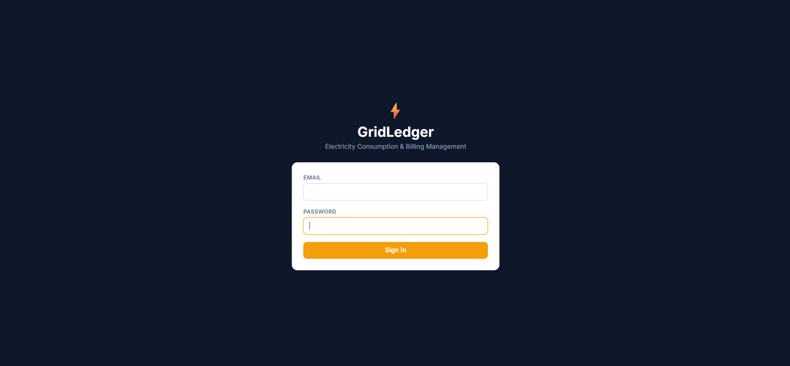

### Admin
| Dashboard | Consumers |
|---|---|
|  | 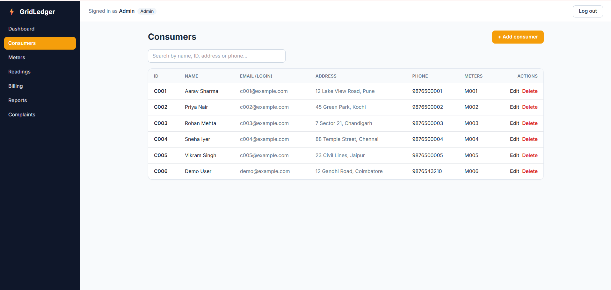 |

| Meters | Readings and CSV import |
|---|---|
| 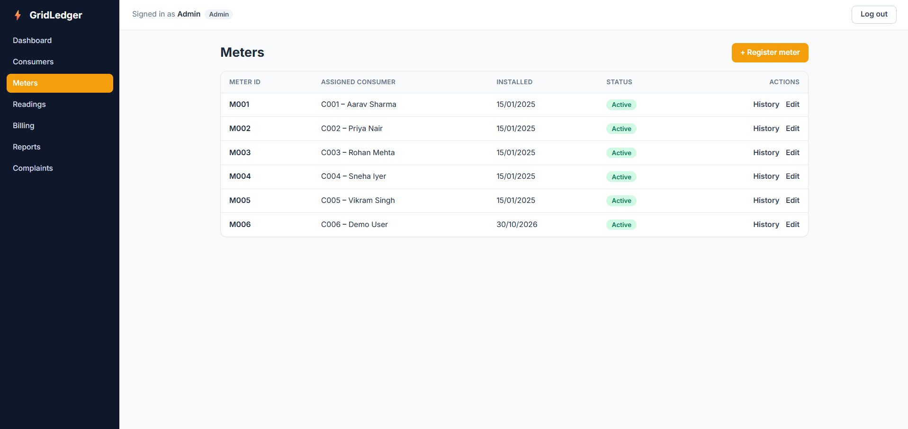 | 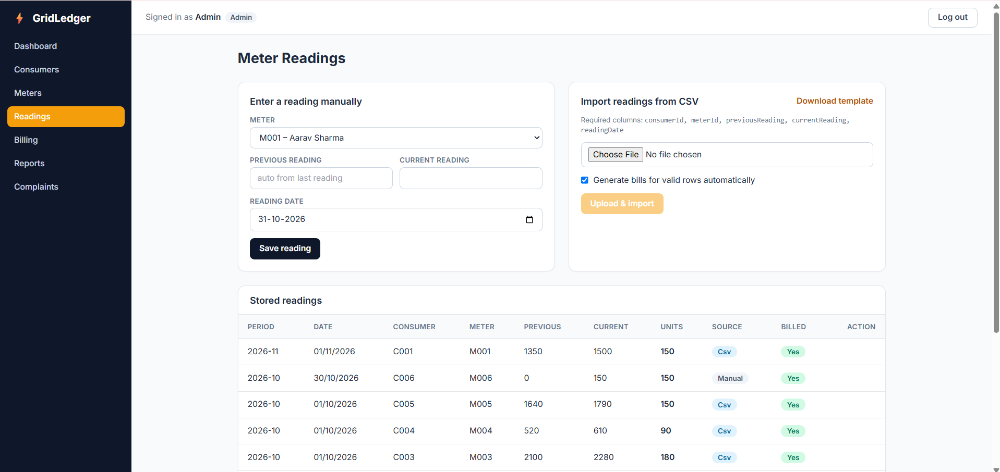 |

| Billing | Reports |
|---|---|
| 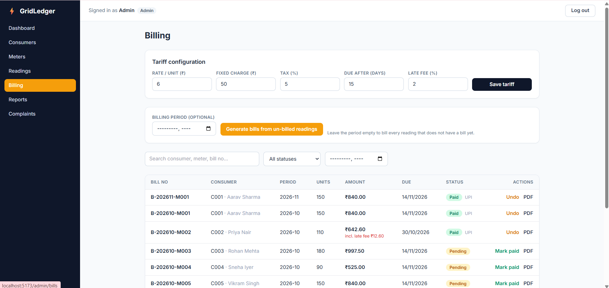 | 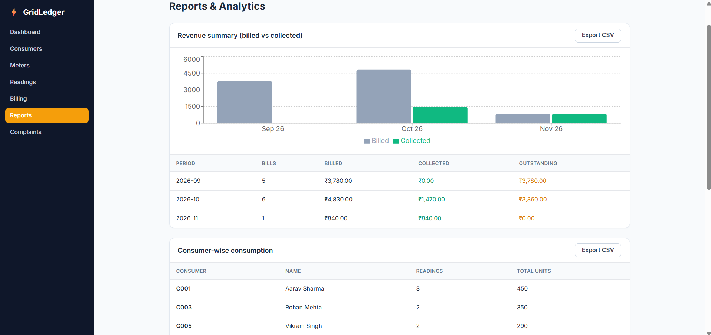 |

| Complaints |
|---|
| 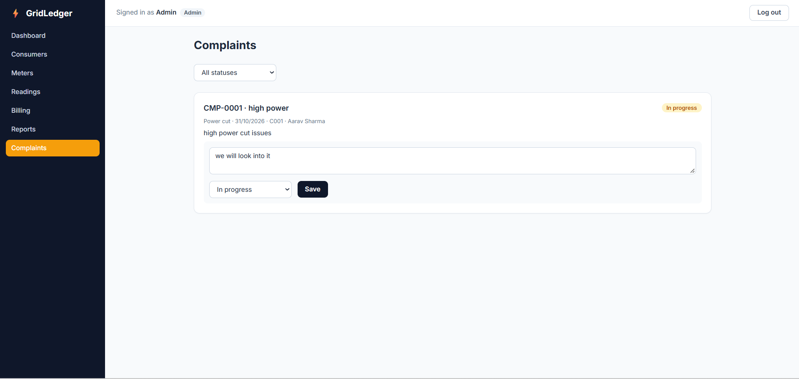 |

### Meter reader
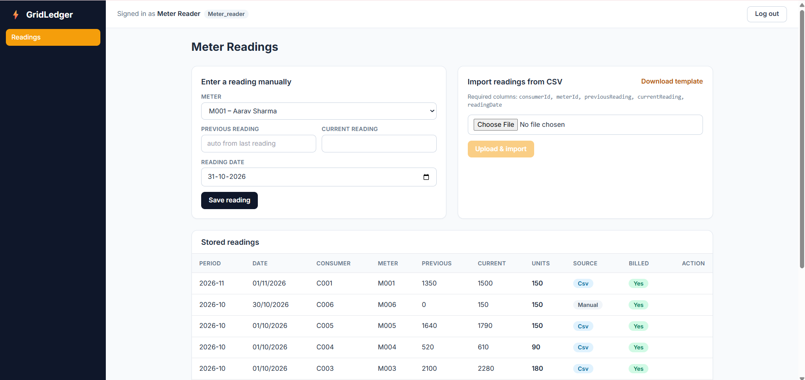

### Consumer
| My account | Billing and Pay Now |
|---|---|
| 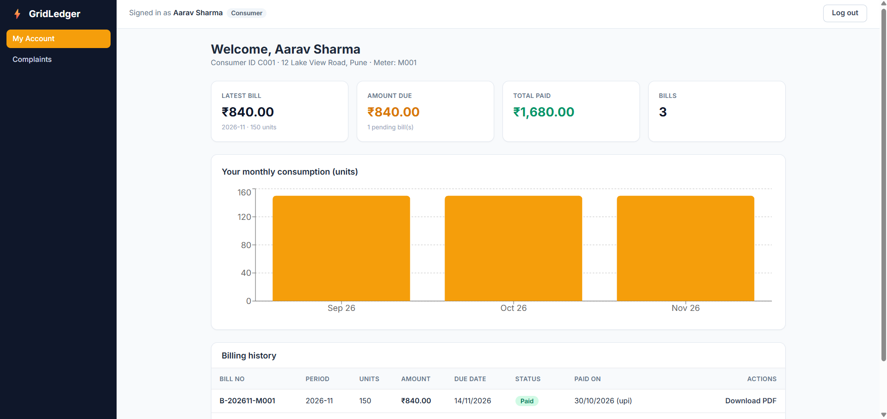 | 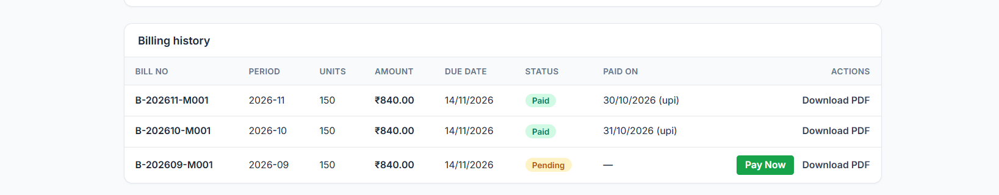 |

| Complaints |
|---|
| 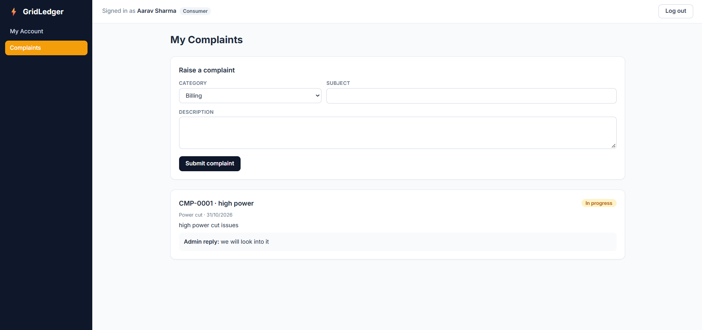 |

---

## Demo walkthrough

1. Log in as **admin**; add a consumer and register a meter.
2. Log in as the **meter reader**; enter a reading manually and delete a mistaken one.
3. As admin, upload `meter-readings-with-errors.csv` and show the rejected rows with reasons.
4. Upload the valid CSVs and **generate bills**.
5. Change the tariff and generate a new bill to show the rate is configurable.
6. Log in as a **consumer**; view bills, download the PDF, and use **Pay Now**.
7. Raise a complaint as the consumer; reply to it as admin.
8. Show the admin **dashboard** and **reports** updating from real database values.

---

## Limitations and future scope

- Payments are simulated; a real gateway (Razorpay, Stripe) can be integrated
- No email or SMS notifications for due dates
- Single flat tariff; slab-based tariffs can be added
- Reports show base bill amounts and do not yet include late fees
- Possible extensions: IoT smart-meter integration, consumption prediction, deployment on Render/Vercel

---

## Author

**<Your Name>** – <Register Number>
<Department>, <Institution>
GitHub: [@<your-username>](https://github.com/<your-username>)

Built as a Full Stack Development laboratory project using React.js, Node.js, Express.js and MongoDB.
